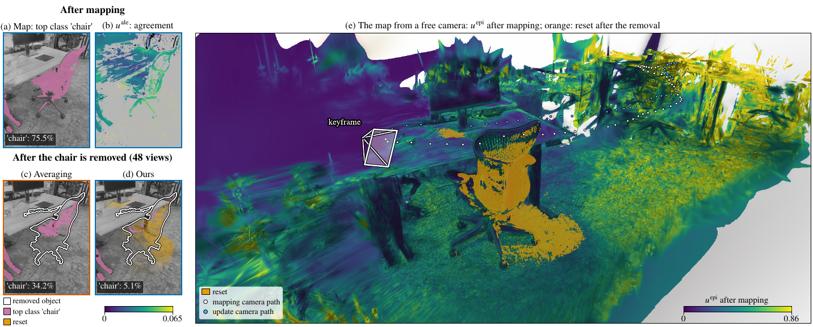

<p align="center">

  <h1 align="center">Uncertainty-Aware Open-Vocabulary Gaussian Splatting for Changing Scenes</h1>
  <p align="center">
    <strong>Anonymous Authors</strong>
  </p>
  <p align="center"><strong>Submitted to IEEE Robotics and Automation Letters (RA-L), 2026</strong></p>
  <h3 align="center">Paper (coming soon) | Video (coming soon) | <a href="#data">Data</a></h3>
  <div align="center"></div>
</p>
<p align="center">
    
</p>

<p align="center">
UAGS gives every Gaussian of a 3D-GS map a posterior over its open-vocabulary feature:
how much evidence supports it, whether its views agree, and when its content has changed.
</p>
<br>

<!-- TABLE OF CONTENTS -->
<details open="open" style='padding: 10px; border-radius:5px 30px 30px 5px; border-style: solid; border-width: 1px;'>
  <summary>Table of Contents</summary>
  <ol>
    <li><a href="#overview">Overview</a></li>
    <li><a href="#installation">Installation</a></li>
    <li><a href="#quick-start">Quick start</a></li>
    <li><a href="#data">Data</a></li>
    <li><a href="#reproduce-the-paper">Reproduce the paper</a></li>
    <li><a href="#results">Results</a></li>
    <li><a href="#repository-structure">Repository structure</a></li>
    <li><a href="#acknowledgement">Acknowledgement</a></li>
    <li><a href="#citation">Citation</a></li>
    <li><a href="#contact">Contact</a></li>
  </ol>
</details>

## Overview

UAGS is a training-free, probabilistic open-vocabulary layer for a fixed 3D Gaussian Splatting map:

- **View-level evidence.** One render and one backward pass give every Gaussian the splat-weighted sum of a
  keyframe's pixel features (the gradient identity of gradient-weighted back-projection). Each keyframe counts as
  at most one observation per Gaussian, with a weight that does not depend on the image resolution.
- **Directional posterior.** Each Gaussian keeps four sums and a von Mises-Fisher posterior over the direction of
  its LSeg feature. Its MAP label equals averaging the same features, so the field costs no accuracy.
- **Two uncertainties.** The epistemic one is the weighted number of views, `u_epi = 1 / (1 + W1)`. The aleatoric
  one, `u_ale = 1 - rho_hat`, is a bias-corrected agreement of the views that does not shrink when evidence is
  scarce, so little evidence and conflicting evidence stay apart.
- **Change handling.** A feature-residual test, with a label-free threshold from the map's own mapping pass, resets
  a changed Gaussian; with depth, it rejoins the robust map only once its observed depth matches its position.
- **Predictive.** A per-pixel temperature that depends on the rendered `u_epi` and `u_ale`.

## Installation

Tested on Ubuntu 20.04, Python 3.12, CUDA 12.8 and an NVIDIA RTX 4070 Ti (12 GB).

1. Clone the repository.
```bash
git clone https://github.com/pairs-lab/uags.git
cd uags
```

2. Create a Python 3.12 environment (venv shown; uv or conda work too).
```bash
python3.12 -m venv .venv
source .venv/bin/activate
```

3. Install PyTorch for CUDA 12.8, then the pinned dependencies.
```bash
pip install torch==2.11.0 torchvision==0.26.0 --index-url https://download.pytorch.org/whl/cu128
pip install -r requirements-eval.txt
```
[requirements-eval.txt](requirements-eval.txt) pins the versions that produced the paper's numbers
([requirements.txt](requirements.txt) lists the minimum versions). **numpy** must stay below 2.

4. gsplat compiles its CUDA extension on first use and needs `nvcc`. Without a system CUDA toolkit, fetch NVIDIA's
   redistributable toolchain into `~/.local/cuda-12.8` (no sudo):
```bash
scripts/setup_cuda_toolchain.sh
export CUDA_HOME=$HOME/.local/cuda-12.8 PATH=$HOME/.local/cuda-12.8/bin:$PATH
```

5. Fetch the LSeg weights (only the `state_dict` of the official `demo_e200.ckpt`, CRC-checked, about 1.7 GB).
```bash
python scripts/fetch_lseg_weights.py data/weights/lseg/demo_e200_state_dict.pt
```

6. Check the installation (CPU only; GPU tests skip without CUDA).
```bash
CUDA_VISIBLE_DEVICES= PYTHONPATH=. python -m pytest tests -q -p no:cacheprovider
```

The code runs from the source tree with `PYTHONPATH=.`, without a pip install. Datasets and weights go under
`data/`, maps, fields and records under `results/` (both git-ignored).

## Quick start

```python
import torch
from usplat.vmf_field import DirectionalSemanticField

torch.manual_seed(0)
d = 8
a, b = torch.eye(d)[0], torch.eye(d)[1]          # two unit features, e.g. 'chair' and 'table'
field = DirectionalSemanticField(num_gaussians=2, feat_dim=d)
for v in range(10):                               # ten keyframes
    # Gaussian 0 sees `a` in every view; Gaussian 1 sees `a` and `b` in turn (conflicting views)
    z = torch.stack([a, a if v % 2 else b]) + 0.05 * torch.randn(2, d)
    field.update_sparse(torch.tensor([0, 1]), torch.full((2,), 50.0), z, num_pixels=320 * 240)

u_ale, _ = field.aleatoric()
print(field.epistemic())                          # tensor([0.0909, 0.0909]): ten views each
print(u_ale)                                      # tensor([0.0087, 0.3406]): Gaussian 1's views disagree
print(field.query(torch.stack([a, b])))           # cosine of the posterior mean direction to each text
```

On a real map, `field.update_from_rasterizer(rasterizer, z_obs)` adds one keyframe from its dense features `z_obs`
with one render and one backward pass of the gsplat feature rasterizer
([usplat/gsplat_adapter.py](usplat/gsplat_adapter.py)); [scripts/run_mapping.py](scripts/run_mapping.py) runs the
whole mapping and update passes.

## Data

All inputs live under `data/`:
```
data/replica_semnerf/Replica_Dataset/<scene>/Sequence_{1,2}   Replica renders of Semantic-NeRF
data/scannet/scans/<scene>/                                   ScanNet v2 scans, scannetv2-labels.combined.tsv
data/nerf_object_removal/nerf-object-removal/<NNN>/           NeRF-Object-Removal (real removals)
data/weights/lseg/demo_e200_state_dict.pt                     LSeg weights (step 5 above)
```

- **Replica.** The renders of [Semantic-NeRF](https://github.com/Harry-Zhi/semantic_nerf) (8 scenes, 101
  classes) of the [Replica dataset](https://github.com/facebookresearch/Replica-Dataset). Validation: office_0,
  room_2; test: room_0, room_1, office_1 to office_4.
- **ScanNet.** Accept the [ScanNet](http://www.scan-net.org/) terms of use and download the ten scenes of
  [OpenGaussian](https://github.com/yanmin-wu/OpenGaussian) (19 classes).
  [scripts/scannet_sens_export.py](scripts/scannet_sens_export.py) exports each `.sens` file to colour, depth,
  pose and intrinsics, and `STAGE=prep scripts/scannet_tab1.sh` prepares the frames. Validation: scene0000_00,
  scene0062_00; test: the other eight.
- **NeRF-Object-Removal.** The real scenes of [Weder et al. (CVPR 2023)](https://github.com/nianticlabs/nerf-object-removal),
  in which an object was physically removed between two sequences. Validation: 001-004; test: 005-011 and 013-015.

The scene lists and vocabularies are in [configs/](configs/). The drivers and configs name the data by absolute
paths of the authors' machine; adapt `ROOT`, `MAPS` and `FIELDS` at the top of each driver and the paths in
`configs/*.json`.

## Reproduce the paper

Every driver runs the validation scenes first, freezes each choice, and then runs the test scenes once: by
default, a second test run, or a test run from uncommitted code, is refused. Every GPU step goes through
[scripts/gpu_gate.sh](scripts/gpu_gate.sh), which waits for free memory on a shared GPU.
```bash
STAGE=val scripts/replica_tab1.sh;  STAGE=test scripts/replica_tab1.sh    # Table I (Replica) and Table II
STAGE=val scripts/scannet_tab1.sh;  STAGE=test scripts/scannet_tab1.sh    # Table I (ScanNet)
STAGE=val scripts/nor_tab2.sh;      STAGE=test scripts/nor_tab2.sh        # Table III, stale content
STAGE=val scripts/replica_views.sh; STAGE=test scripts/replica_views.sh   # Fig. views, reducible vs irreducible error
STAGE=val scripts/replica_tab3.sh;  STAGE=test scripts/replica_tab3.sh    # ablations
```
The table rows come from the saved records with [scripts/make_tables.py](scripts/make_tables.py):
```bash
python3 scripts/make_tables.py tab1pair results/tab1/eval_test.json --val results/tab1/eval_val.json \
    --pair results/scannet_tab1/eval_test.json results/scannet_tab1/eval_val.json      # Table I
python3 scripts/make_tables.py perclasspair results/tab1/eval_test.json --val results/tab1/eval_val.json \
    --pair results/scannet_tab1/eval_test.json results/scannet_tab1/eval_val.json      # Table II
python3 scripts/make_tables.py tab2 results/nor/tab2_relmax/change_test.json           # Table III
python3 scripts/make_tables.py tab3 results/tab3/eval_test.json --val results/tab3/eval_val.json   # ablations
```
The paper sources, the figure, table and video tools and their tests are kept with the paper, outside this
repository.

The registered later attempts of the paper's appendix each have a pre-registration in `configs/*_prereg.json`
and a driver (`smooth_tab1.sh`, `fusion_tab1.sh`, `extractor_tab1.sh`, `reset_fused.sh`, `cusum_reset.sh`,
`whole_update.sh`) that refuses a test run before an accepted validation selection.

## Results

Test scenes, mean over N scenes (copied from the paper). Lower is better except mIoU and AP.

### Segmentation and calibration (Table I): Replica (N = 6) and ScanNet (N = 8)

| Method | mIoU &uarr; | ECE &darr; | NLL &darr; | AURC &darr; | mIoU &uarr; | ECE &darr; | NLL &darr; | AURC &darr; |
|---|---|---|---|---|---|---|---|---|
| | **Replica** | | | | **ScanNet** | | | |
| 2D features, per frame | 26.3 | 11.8 | 1.12 | 16.3 | 62.5 | 8.8 | 0.64 | 7.2 |
| Averaging (training-free) | 27.9 | 9.6 | **1.00** | 14.0 | 67.7 | 6.2 | **0.51** | **4.4** |
| Feature 3DGS (trained) | 27.9 | 10.0 | 1.04 | 14.6 | 65.0 | 7.4 | 0.57 | 5.7 |
| LEGaussians (trained) | 24.0 | 10.6 | 1.14 | 15.8 | 62.3 | 8.1 | 0.63 | 6.3 |
| **Ours P2** (adaptive temperature) | **28.0** | **8.7** | **1.00** | **12.2** | **68.0** | **6.1** | **0.51** | 5.0 |
| CSS, closed set (not ranked) | 28.5 | 5.1 | 1.01 | 11.5 | 67.3 | 7.0 | 0.60 | 8.9 |

Bold: the best ranked row per column (ties share it). Table I is a parity check: every map row lifts the same
LSeg features, and ours ties averaging them. Our `u_ale`
ranks the errors on par with NormLift's cross-view agreement (AUSE 8.5 vs 8.8 on Replica, 8.2 vs 8.3 on ScanNet),
and the semantic layer builds in 5.6 s per ScanNet scene, against 1268 s and 730 s to train Feature 3DGS and
LEGaussians (median).

### Stale content after a real removal (Table III): NeRF-Object-Removal (N = 10)

| Measure | Averaging | Ours |
|---|---|---|
| Removed object's former pixels that still answer its class (after mapping: 48%) | 34% | **21%** |
| Same, in the 8 scenes whose query names the object | 19.5% | **4.8%** |

| Ranking of the stale Gaussians (Gaussian-level AP &uarr;) | Alone | Fused with the depth residual |
|---|---|---|
| Our change test (resets the map) | 53.4 | 75.0 |
| Our whole-update score | 64.6 | 81.0 |
| NormLift's reliability drop | 63.8 | 79.9 |
| Feature residual, averaged over the update | **64.7** | **84.9** |

Our test is the one that resets the map and lowers the stale answers; as a ranking, our field read over the whole
update ties the strongest baselines, and a feature residual averaged the same way ranks best once fused with depth.

## Repository structure

```
usplat/                 the method
  vmf_field.py            the field: sums, vMF posterior, u_epi / u_ale, change test, reset, re-admission
  gsplat_adapter.py       gsplat feature rasterizer (one render + one backward pass per keyframe)
  predictive.py, rows.py  predictive distributions (P0, P1, P2) and the evaluated rows
  baselines.py, distill.py, change_baselines.py   averaging, NormLift, CSS, Feature 3DGS, LEGaussians, residuals
  seg_eval.py, evaluation.py, change_eval.py       metrics (mIoU, ECE, NLL, Brier, AURC, AUSE, AP)
  datasets.py, gs_io.py, feature_pca.py, extractors/   data loaders, 3D-GS I/O, PCA, LSeg (and Appendix D extractors)
scripts/                mapping (fit_gs.py, run_mapping.py), evaluation (eval_seg.py, eval_change_nor.py,
                        eval_views.py), drivers (*.sh), registered attempts (*_nor.py, *_select.py), table
                        rows and paired tests (make_tables.py, quant_stats.py), weights (fetch_lseg_weights.py),
                        GPU gate (gpu_gate.sh)
configs/                scene lists, vocabularies and the pre-registration of every attempt (*_prereg.json)
media/                  README assets
tests/                  unit tests (pytest; CPU, GPU tests skip without CUDA)
```

## Acknowledgement

We build on [gsplat](https://github.com/nerfstudio-project/gsplat), [LSeg](https://github.com/isl-org/lang-seg)
(its inference path is re-implemented in [usplat/extractors/lseg.py](usplat/extractors/lseg.py) to load the
official checkpoint) and [OpenCLIP](https://github.com/mlfoundations/open_clip), and evaluate on the
[Semantic-NeRF](https://github.com/Harry-Zhi/semantic_nerf) renders of
[Replica](https://github.com/facebookresearch/Replica-Dataset), [ScanNet](http://www.scan-net.org/) and
[NeRF-Object-Removal](https://github.com/nianticlabs/nerf-object-removal). Averaging, NormLift, CSS, Feature 3DGS,
LEGaussians and the change residuals are our re-implementations for comparison and may differ from the authors'
code. Thanks to all authors for making their code and data public.

## Citation

If you find this work useful, please cite:
```bibtex
@misc{uags2026,
  title  = {Uncertainty-Aware Open-Vocabulary Gaussian Splatting for Changing Scenes},
  author = {Anonymous},
  note   = {Under review at IEEE Robotics and Automation Letters},
  year   = {2026}
}
```

## Contact

Please open a [GitHub issue](https://github.com/pairs-lab/uags/issues) for questions, comments and bug reports.
